# SyncR architecture, end to end

This document walks through SyncR from the outside in, one diagram at a time:
what the system is, where it runs, how the Go backend is put together, what
happens on the wire when two people share an editor, and how auth, plans and
code execution fit around that.

Every diagram is drawn from the code as it is now, not from the roadmap. Where
something is planned but not built (Redis, for example), the diagram says so.

Diagrams are [Mermaid](https://mermaid.js.org/). GitHub renders them, and so
does VS Code's Markdown preview.

For the full list of REST routes, see [ROUTEMAP.md](ROUTEMAP.md). It is
generated from `main.go`, so it is always current. For why each decision was
made, see [CLAUDE.md](../CLAUDE.md).

---

## Contents

1. [The system at a glance](#1-the-system-at-a-glance)
2. [Where it runs](#2-where-it-runs)
3. [Repository and package map](#3-repository-and-package-map)
4. [Backend startup](#4-backend-startup)
5. [HTTP routing and middleware](#5-http-routing-and-middleware)
6. [The concurrency model](#6-the-concurrency-model)
7. [Inside the hub's event loop](#7-inside-the-hubs-event-loop)
8. [Joining a room](#8-joining-a-room)
9. [Editing together](#9-editing-together)
10. [The WebSocket protocol](#10-the-websocket-protocol)
11. [Room and interview lifecycles](#11-room-and-interview-lifecycles)
12. [Accounts, sessions and tokens](#12-accounts-sessions-and-tokens)
13. [The room gate on the frontend](#13-the-room-gate-on-the-frontend)
14. [Running code](#14-running-code)
15. [Candidate activity monitoring](#15-candidate-activity-monitoring)
16. [Data model](#16-data-model)
17. [Plans, owners and promotion codes](#17-plans-owners-and-promotion-codes)
18. [Frontend structure](#18-frontend-structure)
19. [CI and repository automation](#19-ci-and-repository-automation)
20. [A suggested reading order](#20-a-suggested-reading-order)

---

## 1. The system at a glance

SyncR is a shared code editor for technical interviews. There are two kinds of
person in an interview, and only one of them has an account:

- **Interviewer**: registers, logs in, creates rooms, writes the question.
- **Candidate**: never registers. They hold a link with an invite token, and
  nothing else.

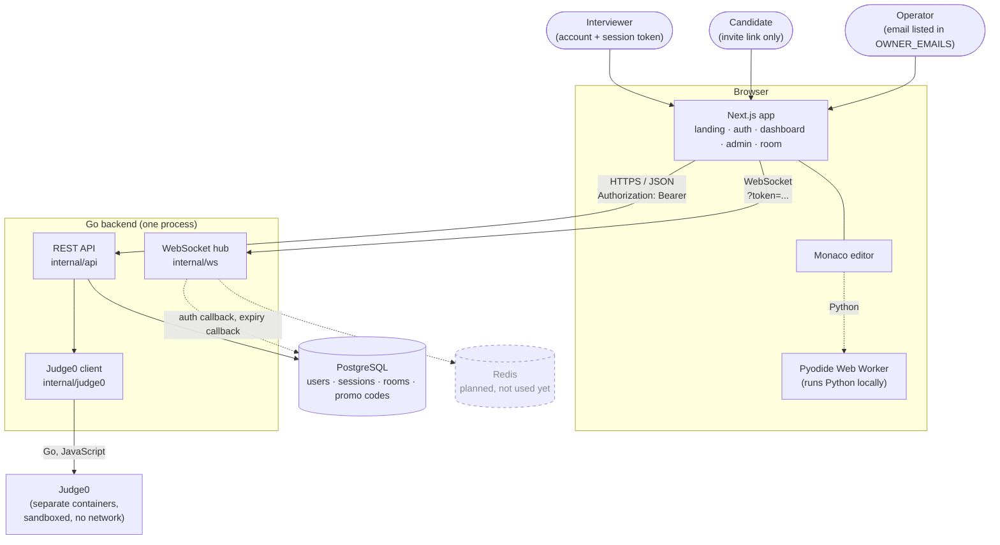

Three things about this picture that matter for the rest of the document:

1. **The browser talks to Go directly** for both REST and WebSocket traffic.
   Next.js renders pages; it never proxies live traffic.
2. **Document state lives in memory, in the hub.** Postgres stores who owns
   which room, not what is typed in it. When the last person leaves, the text
   is gone.
3. **The Go process never runs submitted code.** Python runs in the
   candidate's browser; Go and JavaScript go to Judge0 in its own containers.

---

## 2. Where it runs

### Production

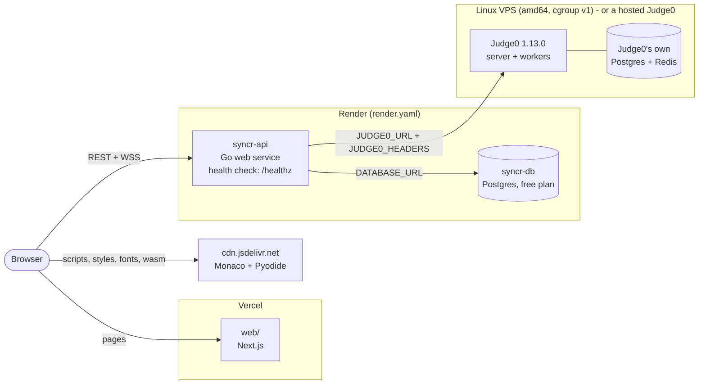

| Environment variable | Read by | Purpose |
|---|---|---|
| `PORT` / `ADDR` | Go | Listen address. `PORT` wins, because a PaaS picks it |
| `DATABASE_URL` | Go | Application Postgres |
| `CORS_ORIGIN` | Go | Allowlist for REST CORS **and** WebSocket `CheckOrigin` |
| `OWNER_EMAILS` | Go | Accounts that are admins and get the unlimited tier |
| `JUDGE0_URL`, `JUDGE0_HEADERS` | Go | Where Judge0 is, and how to authenticate to a hosted one |
| `NEXT_PUBLIC_API_URL`, `NEXT_PUBLIC_WS_URL` | web | Where the Go server is |

Judge0 cannot run on Render, Vercel, or Docker Desktop for Windows. It needs
privileged Docker and cgroup v1. CLAUDE.md has the full story under
"Testing note".

### Local development

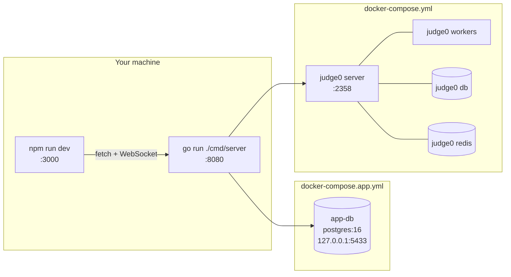

The two compose files are deliberately separate stacks. Judge0's database sits
on a network the sandbox can reach, so the application database must never be
in the same stack.

---

## 3. Repository and package map

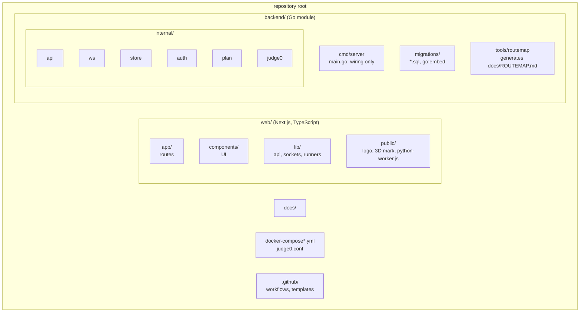

### Who imports whom

The arrows point from importer to imported. The rule worth remembering is the
missing arrow: **`ws` does not import `store`**.

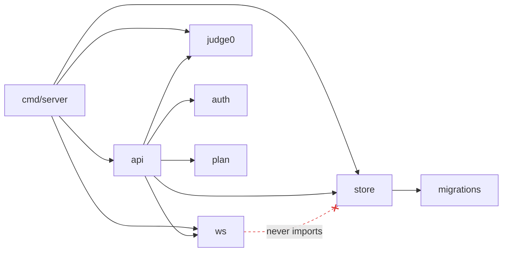

The hub has to ask two questions of the database: "may this token join this
room?" and "this interview just ran out of time, record it". Instead of
importing `store`, it takes both as plain functions:

| In `ws` | Implemented in | Wired in |
|---|---|---|
| `ws.Authorizer` (`func(ctx, roomID, token) (Grant, error)`) | `api.RoomAuthorizer` | `main.go` |
| `onEnded func(roomID string)` | closure calling `store.CloseExpiredRoom` | `main.go` |

That keeps `ws` a package that moves text between sockets, testable with
`ws.AllowAll` and no database.

---

## 4. Backend startup

What `main.go` does, in order:

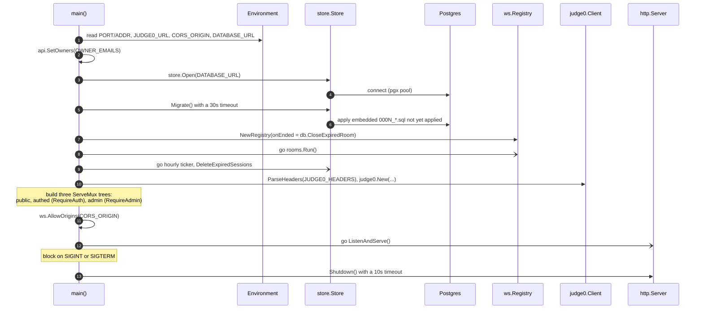

Migrations run at startup rather than as a separate deploy step, so the schema
cannot fall behind the code. A malformed `JUDGE0_HEADERS` is fatal at startup
rather than at the first Run.

---

## 5. HTTP routing and middleware

Every request enters one top-level mux. The WebSocket route is outside the
`/api/` tree, and so outside CORS.

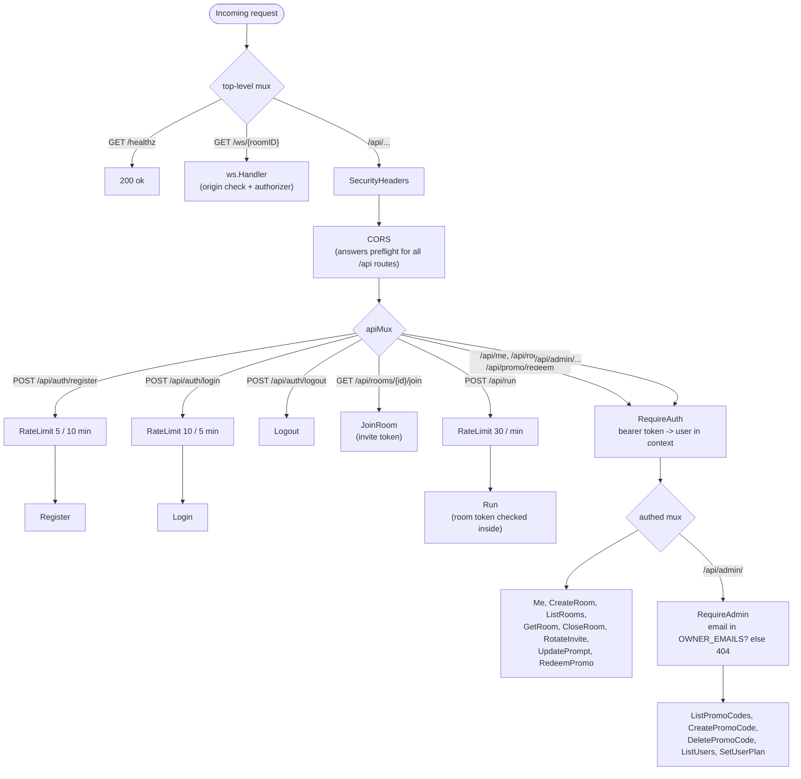

Two conventions run through all of this:

- **404, never 403**, both for someone else's room and for the admin API. "Not
  yours" and "does not exist" look the same from outside.
- **Rate limits are in memory.** They reset on restart and do not add up across
  instances. Fine for one instance.

---

## 6. The concurrency model

This is the main thing the project was built to explore. There are **no
mutexes around room state**. Each piece of mutable state has exactly one
goroutine that owns it, and everyone else sends that goroutine a message.

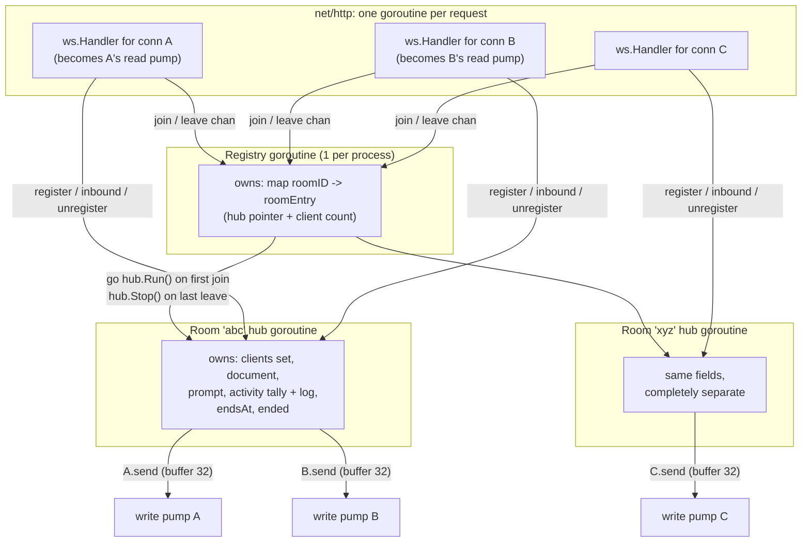

Goroutines per process:

| Goroutine | How many | Owns |
|---|---|---|
| Registry `Run` | 1 | the map of live rooms, and a client count per room |
| Hub `Run` | 1 per live room | everything about that room |
| Read pump (the HTTP handler goroutine) | 1 per connection | reading the socket |
| Write pump | 1 per connection | writing the socket |
| Session sweeper | 1 | nothing; calls `DeleteExpiredSessions` hourly |

### Why two pumps per connection

`gorilla/websocket` allows one concurrent reader and one concurrent writer per
connection. The split keeps inside that rule without a lock:

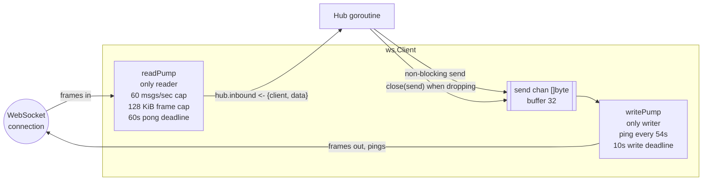

### Backpressure: a slow client is dropped, not waited for

The hub is the room's only thread of control. If it blocked on one slow
socket, everyone in the room would freeze. So every delivery is a
non-blocking send:

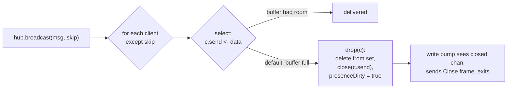

`presenceDirty` is set instead of broadcasting presence right away, because a
drop can happen in the middle of a broadcast's loop over the client map.
`flushPresence` runs once per loop iteration, after the current message is
fully handled.

---

## 7. Inside the hub's event loop

One `for { select { ... } }` loop. Each case runs to completion before the next
message is looked at, which is what gives edits a single well-defined order.

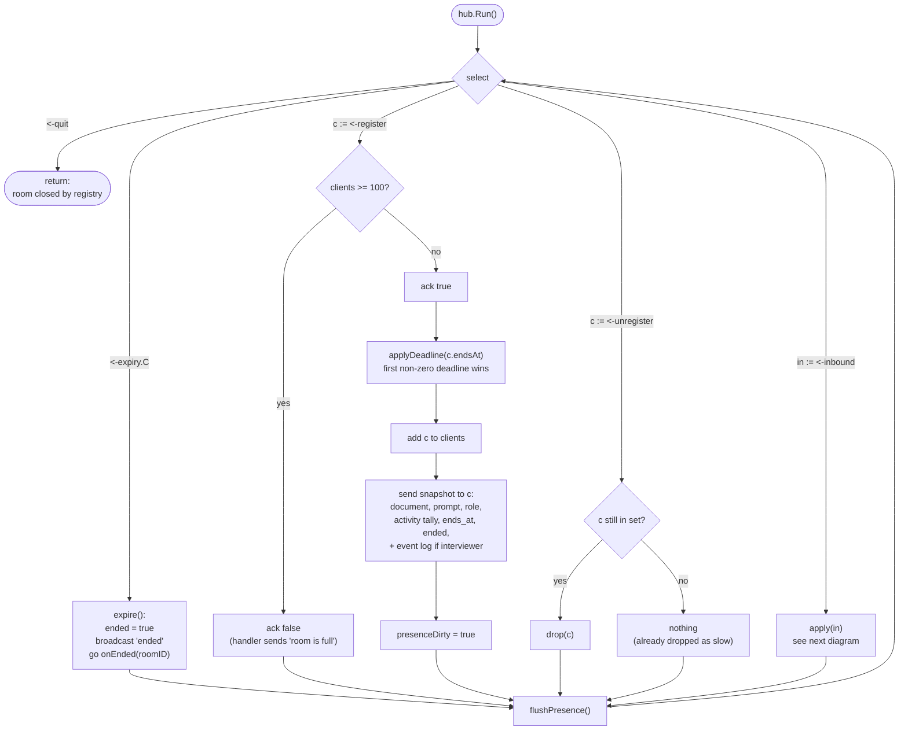

And `apply`, which decides what an inbound frame is allowed to do:

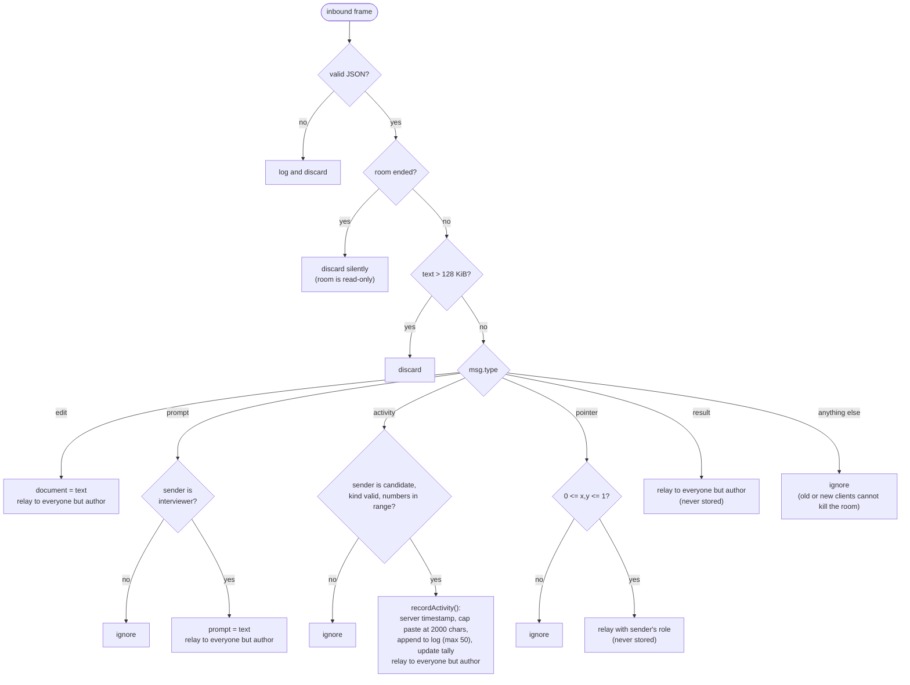

---

## 8. Joining a room

The full path from a browser opening a socket to receiving its first snapshot.
The order of the steps is deliberate: everything that can refuse the
connection happens **before** the upgrade, so the browser gets a real HTTP
status code instead of a socket that opens and immediately closes.

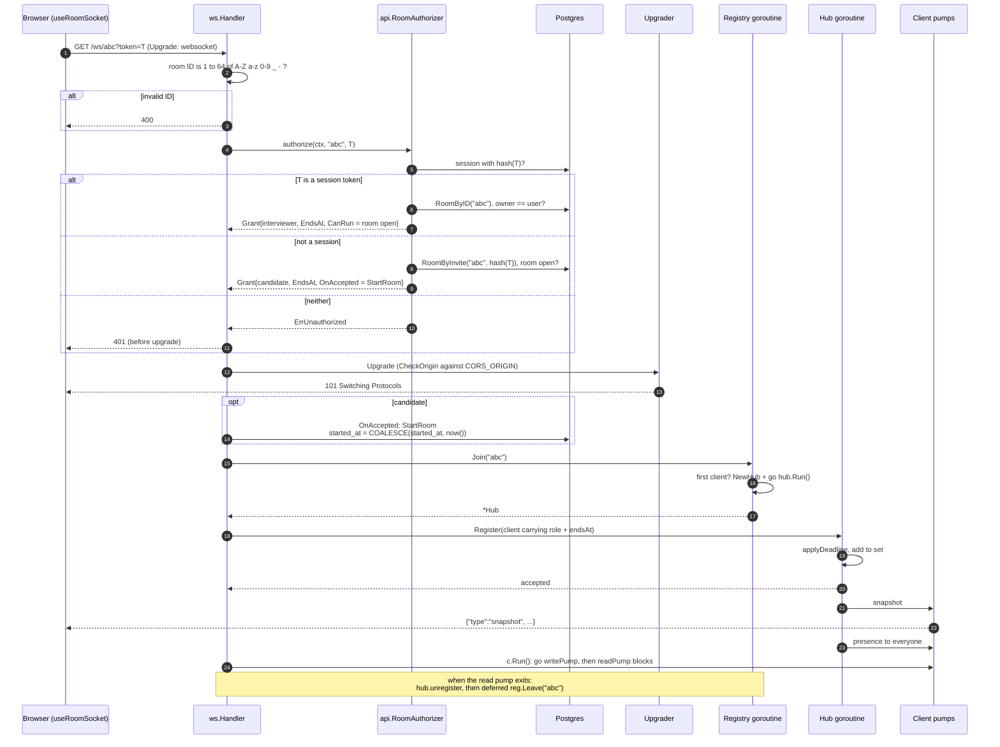

Why the token is in the query string: browsers cannot set headers on a
WebSocket handshake.

Why `CheckOrigin` matters: CORS does not apply to WebSocket upgrades. Without
the origin check, any web page could open a socket using a token from the
victim's browser. The default is to refuse any browser origin that is not
configured.

Why the candidate's clock starts in `OnAccepted` and not in the authorizer: a
handshake that fails partway must not start somebody's interview timer.

> **A possible bug to look at.** In `api/wsauth.go`, the `OnAccepted` closure
> sets `grant.EndsAt` on the authorizer's *local* `grant`. The authorizer has
> already returned a *copy* of that struct, and `ws.Handler` builds the client
> from its own copy. So when the candidate is the one who starts the clock,
> their client seems to carry a zero deadline, and the hub gets no countdown
> until somebody joins later with the real one. Nothing tests `OnAccepted`'s
> effect on the deadline today. This document only reports it; it has not been
> fixed.

---

## 9. Editing together

Edits carry the **whole document**, not a diff. The hub processes them one at
a time in arrival order, so "last write wins" is well defined without
Operational Transformation.

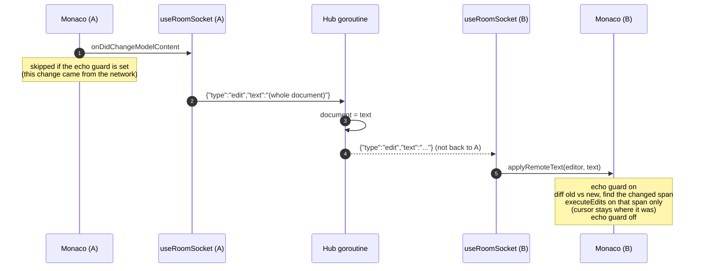

Two details that are easy to trip over:

- **`applyRemoteText` diffs rather than calling `setValue`.** `setValue` would
  work, but it moves the local cursor on every keystroke the other person
  makes.
- **Go's `omitempty` drops an empty `text`.** An empty snapshot arrives as
  literally `{"type":"snapshot"}`, so the client reads `text ?? ""`. An empty
  snapshot means "you are first here", and the client seeds the room with its
  local starter code instead of blanking itself.

### Two edits arriving at once

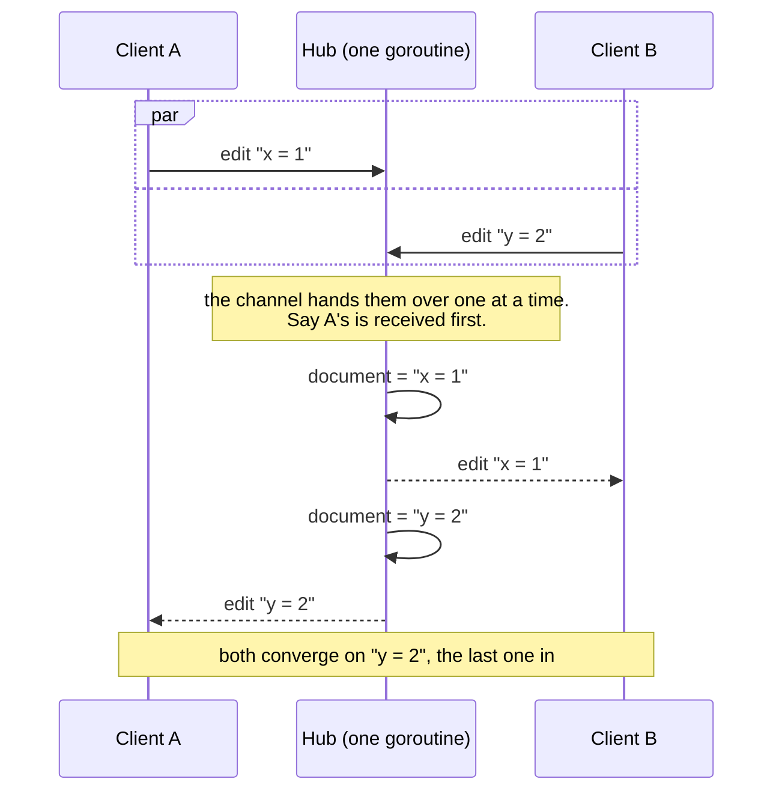

---

## 10. The WebSocket protocol

One JSON envelope (`ws.Message`) in both directions.

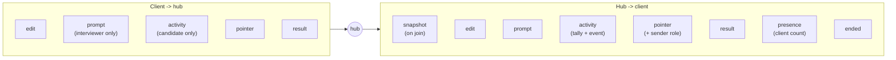

| Type | Direction | Fields | Stored in the hub? | Who may send |
|---|---|---|---|---|
| `snapshot` | server to client | `text`, `prompt`, `role`, `activity`, `ends_at`, `ended`, `events` (interviewers only) | is the stored state | server |
| `edit` | both | `text` | yes, the document | anyone |
| `presence` | server to client | `clients` | derived | server |
| `result` | both | `text`, `failed` | no | anyone |
| `prompt` | both | `prompt` | yes | interviewer |
| `activity` | both | `kind`, `lines`, `ms`, `text`; out: `activity`, `event` | yes, tally + last 50 events | candidate |
| `pointer` | both | `x`, `y` (0 to 1), `role` | no | anyone |
| `ended` | server to client | none | sets `ended` | server |

"Relayed" always means to **everyone except the author**, who already has the
content locally.

### What the client does with each frame

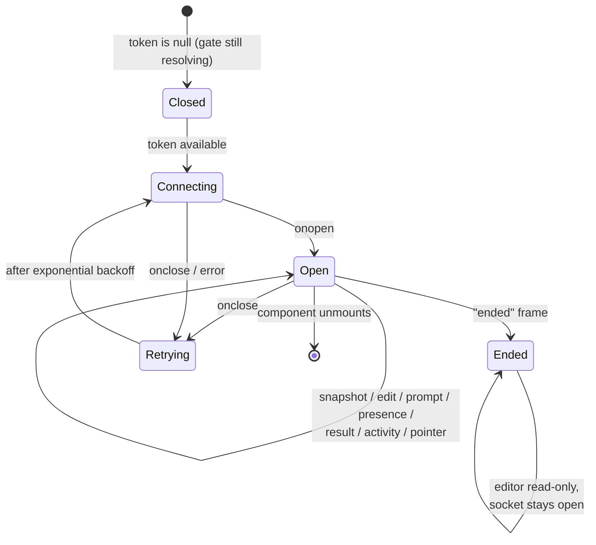

---

## 11. Room and interview lifecycles

A "room" means two different things, and it helps to keep them apart.

### The live room: in memory, per process

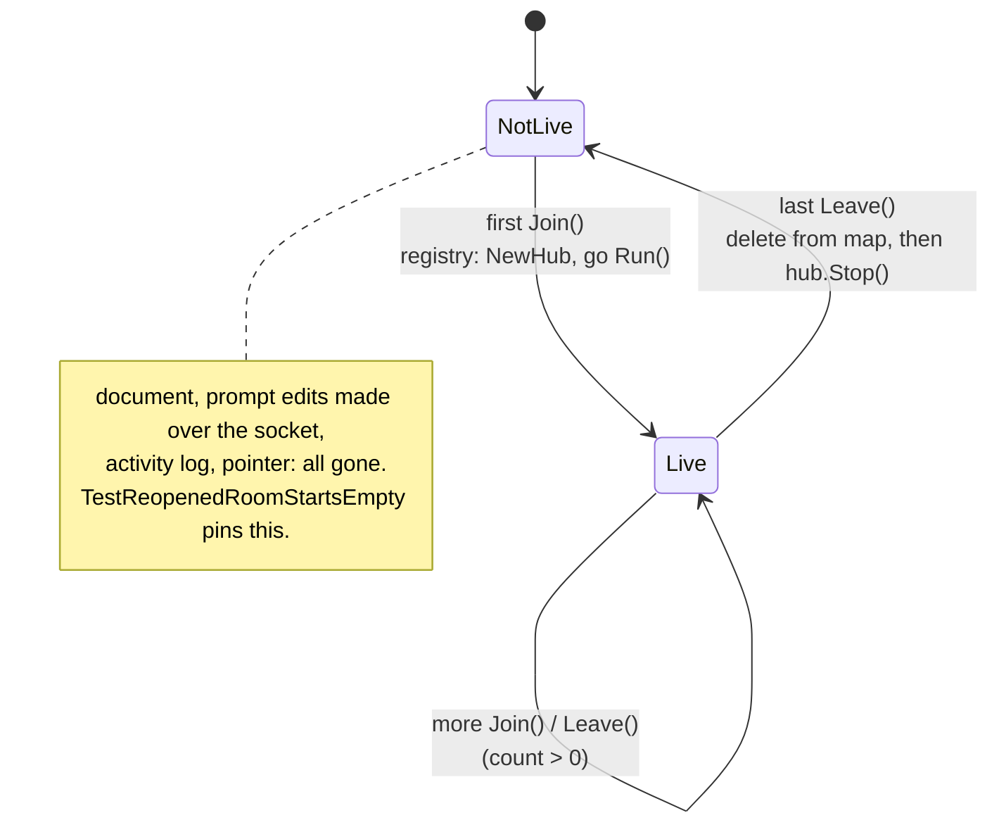

Deleting from the map **before** stopping the hub means no later `Join` can
be handed a hub that is shutting down. Both decisions happen on the same
registry goroutine, in order.

### The interview record: in Postgres

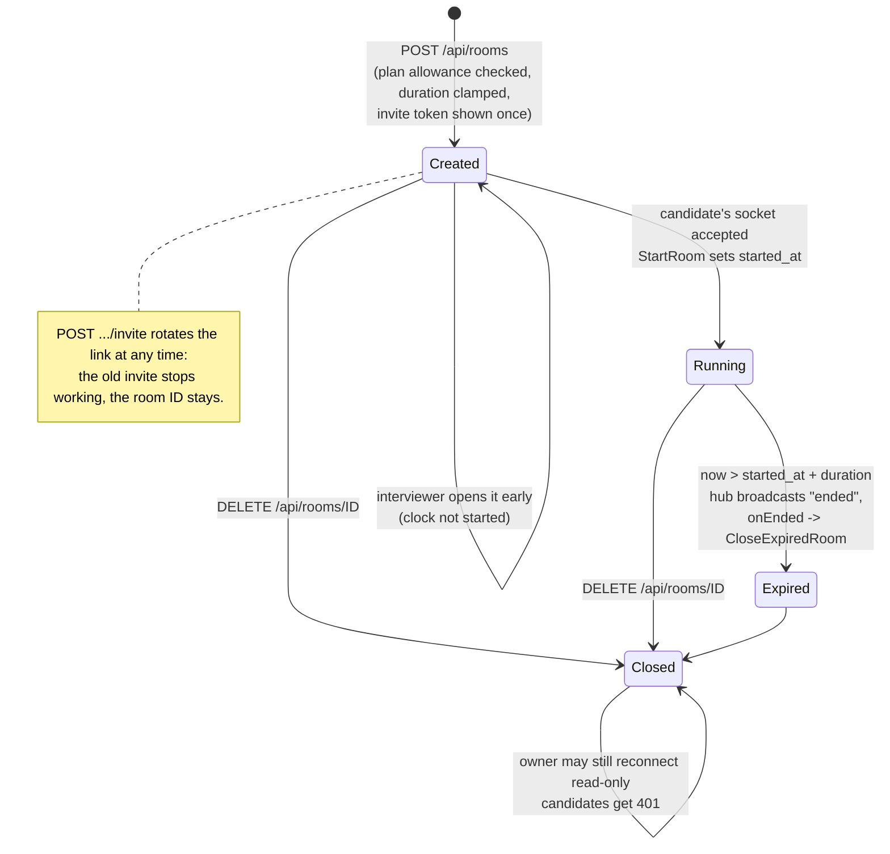

The clock starts when the **candidate** arrives, not at booking and not when
the interviewer opens the room. `COALESCE(started_at, now())` makes the first
write win if two people arrive in the same instant.

On expiry **nobody is disconnected**. The room turns read-only so both people
can still read and copy the code.

---

## 12. Accounts, sessions and tokens

### Registering and logging in

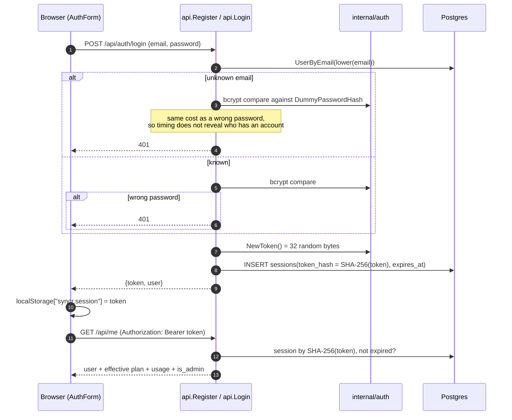

### Three kinds of secret, handled three ways

```mermaid
flowchart LR
  subgraph pw["Password"]
    p1["chosen by a person<br/>low entropy"] --> p2["bcrypt<br/>(slow on purpose)"] --> p3[("users.password_hash")]
  end
  subgraph tok["Session and invite tokens"]
    t1["32 bytes from crypto/rand<br/>nothing to brute-force"] --> t2["SHA-256<br/>(fast, on every request)"] --> t3[("sessions.token_hash<br/>rooms.invite_token_hash")]
  end
  subgraph promo["Promotion code"]
    c1["a coupon, typed by hand,<br/>shared on purpose"] --> c2["upper-case,<br/>strip whitespace"] --> c3[("promo_codes.code<br/>plain text")]
  end
```

- Tokens are **opaque rows, not JWTs**, so logout deletes a row and the token
  is dead immediately.
- The session token travels as **`Authorization: Bearer`**, not a cookie,
  because the web app and the API are on different origins in every
  environment. The trade-off is written at the top of `internal/api/auth.go`.
- The **invite token is shown once**, on create and on rotate, because only its
  hash is stored.

---

## 13. The room gate on the frontend

`components/RoomGate.tsx` works out who is at the door **before** any socket
opens. It has to: a refused WebSocket handshake reaches JavaScript as close
code 1006, the same code as a dropped connection, so a socket on its own cannot
tell "not allowed" from "wifi died".

```mermaid
flowchart TB
  start(["/room/abc opened"]) --> latch["latch ?t= from the URL into state<br/>on first render"]
  latch --> has{"invite from URL<br/>or sessionStorage?"}

  has -- yes --> save["sessionStorage['...abc'] = invite<br/>history.replaceState: remove ?t="]
  save --> joinapi["GET /api/rooms/abc/join?token=invite"]
  joinapi -- "200" --> cand["role = candidate<br/>socket token = invite"]
  joinapi -- "refused" --> clear["clear sessionStorage entry"] --> denied

  has -- no --> sess{"session token<br/>in localStorage?"}
  sess -- no --> denied["'Not open to you' screen<br/>with the right way out"]
  sess -- yes --> getapi["GET /api/rooms/abc<br/>(Bearer)"]
  getapi -- "200" --> intv["role = interviewer<br/>socket token = session"]
  getapi -- "404 / 401" --> denied

  cand & intv --> editor["RoomEditor<br/>useRoomSocket(token) connects"]
```

Why each step is there:

| Step | The bug it prevents |
|---|---|
| Invite checked first | Someone sent a link would be treated as an interviewer if they also had a session in that browser |
| Token latched into state, not read live | Next.js feeds `replaceState` back into `useSearchParams`, so the token went null the moment the URL was cleaned and the join was aborted |
| Copy kept in `sessionStorage`, per room | Once the URL is cleaned it is the only copy; without it a reload locked the candidate out of their own interview |
| `?t=` removed from the address bar | The invite would otherwise sit in screenshots, screen shares and history |

---

## 14. Running code

Two paths, chosen by language. Both end the same way: the output is shown
locally and relayed to the other person as a `result` frame.

```mermaid
flowchart TB
  run(["Run pressed in RoomEditor"]) --> lang{"language"}

  lang -- python --> py["runPython(source)"]
  py --> worker["public/python-worker.js<br/>(Web Worker)"]
  worker --> pyo["Pyodide: CPython in WebAssembly<br/>loaded from jsDelivr,<br/>prefetched when Python is selected"]
  pyo --> pyout["{output, failed}<br/>10s timeout, never throws"]

  lang -- "go / javascript" --> rc["runCode(language, source, roomId, token)"]
  rc --> post["POST /api/run"]
  post --> v1{"language in<br/>our allowlist?"}
  v1 -- no --> e400["400"]
  v1 -- yes --> v2{"room token valid<br/>and room can run?"}
  v2 -- no --> e401["401"]
  v2 -- yes --> j0["judge0.Client.Run<br/>submit with wait=false, then poll"]
  j0 --> sandbox["Judge0 worker<br/>isolate sandbox, no network"]
  sandbox --> norm["normalised Result<br/>(Judge0 failures become 502,<br/>internals are logged, not returned)"]

  pyout & norm --> show["show in the output panel"]
  show --> relay["send {type: 'result', text, failed}<br/>hub relays it to the other person"]
```

Why Python runs in the browser: on a managed host there is no sandbox. Running
`python3` inside the Go process would let a candidate read `DATABASE_URL` from
the environment. Running it in the candidate's own tab means nothing of ours is
near the code. The trade-off is that the output is not verified, which matters
little when someone is watching live.

Judge0 language IDs (`60` Go, `63` JavaScript, `71` Python) are pinned to the
`judge0/judge0:1.13.0` image. Re-check them against `GET /languages` if the
image or the host changes.

---

## 15. Candidate activity monitoring

Detection only. A browser cannot stop anyone opening another tab, so every
event is a signal, never proof. The candidate is always shown a banner saying
what is tracked, including that pasted text is captured.

```mermaid
sequenceDiagram
  autonumber
  participant Cand as Candidate tab<br/>(useActivityReporter)
  participant Hub as Hub goroutine
  participant Int as Interviewer<br/>(ActivityPanel)

  Note over Cand: visibilitychange / window blur<br/>(both fire for one switch)
  Cand->>Hub: activity {kind: "away"} (leading edge only)
  Hub->>Hub: away already true? then do not count again<br/>else away = true, away_count++
  Hub-->>Int: activity {tally, event with server timestamp}

  Note over Cand: focus returns
  alt away for less than 1.5s
    Cand->>Cand: ignore (notification, click on browser chrome)
  else
    Cand->>Hub: activity {kind: "back", ms}
    Hub->>Hub: away = false, away_ms += ms
    Hub-->>Int: activity {tally, event}
  end

  Note over Cand: Monaco onDidPaste
  Cand->>Hub: activity {kind: "paste", lines, text}
  Hub->>Hub: cut text to 2000 chars (truncated = true)<br/>paste_count++, append to log (keep last 50)
  Hub-->>Int: activity {tally, event with text}

  Note over Int: reloads the page
  Int->>Hub: (re)join
  Hub-->>Int: snapshot with tally + full event log
```

What is deliberately **not** collected: keystrokes and mouse movement. The
tally lives in the hub rather than the interviewer's browser, so a reload does
not reset it. The log is sent to interviewers only. Interviewer activity is
never reported.

---

## 16. Data model

Four migrations in `backend/migrations/`, embedded into the binary and applied
at startup.

```mermaid
erDiagram
  users ||--o{ sessions : "logs in with"
  users ||--o{ rooms : owns
  users ||--o{ promo_redemptions : redeemed
  promo_codes ||--o{ promo_redemptions : "claimed as"

  users {
    bigserial id PK
    text email "unique on lower(email)"
    text password_hash "bcrypt"
    text plan "free, pro, enterprise or unlimited"
    text promo_code "no FK, a record for support"
    text promo_plan "grant that overrides plan"
    timestamptz promo_expires_at "NULL = never lapses"
    timestamptz created_at
  }

  sessions {
    bytea token_hash PK "SHA-256 of the token"
    bigint user_id FK
    timestamptz created_at
    timestamptz expires_at
  }

  rooms {
    text id PK "URL-safe, 1 to 64 chars"
    bigint owner_id FK
    text title
    bytea invite_token_hash "SHA-256, rotatable"
    text language "default python"
    text prompt "default empty"
    timestamptz scheduled_at "advisory"
    int duration_minutes "1 to 480, clamped to plan"
    timestamptz started_at "set when the candidate arrives"
    timestamptz created_at
    timestamptz closed_at "NULL = open"
  }

  promo_codes {
    text code PK "upper case, 4 to 64 chars"
    text plan "tier it grants"
    int max_redemptions "0 = no ceiling"
    int redemptions
    timestamptz expires_at "coupon deadline"
    int grant_days "NULL = grant never lapses"
    text note
    timestamptz created_at
  }

  promo_redemptions {
    text code PK, FK
    bigint user_id PK, FK
    timestamptz redeemed_at
  }
```

| Migration | Adds |
|---|---|
| `0001_init.sql` | `users`, `sessions`, `rooms` |
| `0002_room_prompt.sql` | `rooms.prompt` |
| `0003_plans_and_timing.sql` | `users.plan`; `rooms.scheduled_at`, `duration_minutes`, `started_at` |
| `0004_promo_codes.sql` | `promo_codes`, `promo_redemptions`; the three `users.promo_*` columns |

What is **not** in the database: the document text, the activity log, pointer
positions and run results. All of those live in the hub and die with it.

---

## 17. Plans, owners and promotion codes

### Which tier applies to a user

`api.effectivePlan` checks three sources, most specific first. Everything that
enforces a limit reads this function, never `users.plan` directly.

```mermaid
flowchart TB
  u(["user"]) --> own{"email in<br/>OWNER_EMAILS?"}
  own -- yes --> unl["plan.Unlimited"]
  own -- no --> promo{"promo_plan set and<br/>promo_expires_at not passed?"}
  promo -- yes --> pp["plan.ByName(promo_plan)"]
  promo -- no --> base["plan.ByName(users.plan)<br/>unknown value -> Free"]
```

`isAdmin` is a **separate** check that only reads `OWNER_EMAILS`. An
unlimited *plan* must never grant admin access; a comped customer is on the
same tier as the operator. `TestUnlimitedPlanDoesNotImplyAdmin` guards this.

| | Free | Pro | Enterprise | Unlimited |
|---|---|---|---|---|
| Interviews | 2 for life | 30 / month | no limit | no limit |
| Each interview | 10 min | 60 min | no limit | no limit |
| Billing | none | $10/mo | metered per interview-hour | comped |

Creating a room over the allowance answers **402**, not 403: it is not a
permission problem, and the client can offer an upgrade. A duration over the
tier's limit is clamped, not rejected.

### Redeeming a promotion code

The whole redemption is one transaction holding a lock on the coupon row,
because every interesting failure here is a race.

```mermaid
sequenceDiagram
  autonumber
  participant B as Browser (PromoRedeem)
  participant API as api.RedeemPromo
  participant PG as Postgres (one transaction)

  B->>API: POST /api/promo/redeem {code}
  API->>API: per-account limiter: under 10 failures/hour?
  API->>API: normalise: upper-case, strip whitespace
  API->>PG: BEGIN
  API->>PG: SELECT ... FROM promo_codes WHERE code = $1 FOR UPDATE
  alt no such code
    API->>PG: ROLLBACK
    API-->>B: error (counts as a failure)
  end
  API->>API: plan.Grantable(code.plan)? checked before any write,<br/>so a typo in the plan column costs the redeemer nothing
  alt coupon expired, or redemptions at max_redemptions
    API->>PG: ROLLBACK
    API-->>B: error
  end
  API->>PG: INSERT promo_redemptions (code, user_id)
  alt primary key conflict: already redeemed
    API->>PG: ROLLBACK
    API-->>B: error
  end
  API->>PG: UPDATE promo_codes SET redemptions = redemptions + 1
  API->>PG: UPDATE users SET promo_code, promo_plan, promo_expires_at
  API->>PG: COMMIT
  API-->>B: same shape as /api/me (client swaps its user object)
```

The locked row is what makes `max_redemptions` a real ceiling:
`TestRedemptionCeilingHoldsUnderConcurrentRedeems` races ten accounts at a
three-seat code. The primary key on `promo_redemptions` stops a 30-day code
being redeemed again every morning.

### The admin area

```mermaid
flowchart LR
  dash["/dashboard"] -- "link shown only if<br/>/api/me says is_admin" --> adm["/admin<br/>components/Admin.tsx"]
  adm --> codes["promo codes:<br/>list, issue, revoke<br/>(optionally strip grants)"]
  adm --> users["accounts:<br/>tier, rooms, minutes used,<br/>change subscription"]
  codes & users --> api["/api/admin/*<br/>RequireAuth -> RequireAdmin"]
```

`is_admin` in the UI is only a rendering hint. `RequireAdmin` on the server is
the actual boundary.

---

## 18. Frontend structure

### Routes

```mermaid
flowchart LR
  layout["app/layout.tsx<br/>Splash, noscript escape,<br/>fonts, CSP from next.config.ts"]

  layout --> home["/<br/>Nav, Hero + HeroVisual (Logo3D),<br/>Features, Pricing, FAQ, Footer"]
  layout --> login["/login<br/>AuthForm"]
  layout --> register["/register<br/>AuthForm"]
  layout --> dash["/dashboard<br/>Dashboard, PromoRedeem"]
  layout --> admin["/admin<br/>Admin"]
  layout --> room["/room/[roomId]<br/>RoomGate -> RoomEditor"]

  home -- "Get started" --> register
  login --> dash
  register --> dash
  dash -- "open a room" --> room
  room -- "back (interviewer only)" --> dash
```

### The room page

```mermaid
flowchart TB
  gate["RoomGate<br/>who is this? which token?"] --> ed["RoomEditor"]

  ed --> top["top bar:<br/>title, connection status, peer avatars,<br/>Away badge, Countdown, pointer toggle, Run"]
  ed --> split["SplitPane (draggable)"]
  split --> left["tabs: Prompt | Activity<br/>(Activity is interviewer only)"]
  left --> act["ActivityPanel"]
  split --> split2["SplitPane"]
  split2 --> monaco["Monaco<br/>theme syncr-light,<br/>automaticLayout: true"]
  split2 --> out["output panel"]
  ed --> ptr["PointerLayer<br/>pointer-events: none"]

  ed -. uses .-> sock["lib/useRoomSocket"]
  ed -. uses .-> art["lib/applyRemoteText"]
  ed -. uses .-> rep["lib/useActivityReporter<br/>(candidate)"]
  ed -. uses .-> runners["lib/runPython, lib/runCode"]
```

### The `lib/` layer

| File | Talks to | Job |
|---|---|---|
| `api.ts` | Go REST | the only place `fetch` is called; keeps the token in `localStorage` (inside try/catch) |
| `useAuth.ts` | `api.ts` | asks the server who the token belongs to; renders nothing while `loading` |
| `useSession.ts` | `localStorage` | cheap "is there a token?" via `useSyncExternalStore`, for the nav only |
| `useRoomSocket.ts` | Go WebSocket | connect, reconnect with backoff, parse frames, expose state |
| `applyRemoteText.ts` | Monaco | apply a remote document without moving the cursor |
| `useActivityReporter.ts` | the socket | away, back and paste events from the candidate |
| `runPython.ts` | Web Worker | Pyodide, with a timeout |
| `runCode.ts` | `POST /api/run` | Go and JavaScript via Judge0 |

Monaco and Pyodide both load from `cdn.jsdelivr.net`, so the CSP in
`web/next.config.ts` has to allow that host for scripts, styles **and** fonts.
Missing `style-src` produced a broken editor that no build or type check
could catch.

---

## 19. CI and repository automation

```mermaid
flowchart LR
  pr(["pull request<br/>or push to main"]) --> ci["ci.yml"]

  ci --> go["Go job"]
  go --> g1["gofmt -l, fail if it lists anything"] --> g2["go vet"] --> g3["go build"] --> g4["go test -race ./...<br/>with a Postgres service,<br/>migrations from an empty schema"]

  ci --> node["Next.js job"]
  node --> n1["npm ci"] --> n2["tsc --noEmit"] --> n3["eslint"] --> n4["next build"]

  ci --> vuln["govulncheck job<br/>(separate, so a new CVE<br/>does not hide a test failure)"]

  other(["other workflows"]) --> codeql["codeql.yml"]
  other --> title["pr-title.yml<br/>conventional commits"]
  other --> labeler["labeler.yml, triage.yml, stale.yml"]
  dep["dependabot.yml<br/>weekly, grouped:<br/>gomod, npm, actions"] --> pr
```

CI does not gate deployment. Render and Vercel build from the push itself.

To reproduce the timing-sensitive hub tests locally:

```bash
GOMAXPROCS=2 go test -race -count=80 ./internal/ws/
```

---

## 20. A suggested reading order

Following one request at a time through the code is the fastest way to build a
picture of it. This order follows the diagrams above.

```mermaid
flowchart TB
  s1["1. backend/cmd/server/main.go<br/>everything is wired here"] --> s2["2. internal/ws/message.go<br/>the protocol"]
  s2 --> s3["3. internal/ws/registry.go<br/>rooms opening and closing"]
  s3 --> s4["4. internal/ws/hub.go<br/>the core: one goroutine owns a room"]
  s4 --> s5["5. internal/ws/client.go + handler.go<br/>pumps and the join path"]
  s5 --> s6["6. internal/ws/*_test.go<br/>what the design promises"]
  s6 --> s7["7. web/lib/useRoomSocket.ts + applyRemoteText.ts<br/>the other end of the socket"]
  s7 --> s8["8. web/components/RoomEditor.tsx + RoomGate.tsx"]
  s8 --> s9["9. internal/api/auth.go + wsauth.go + auth/<br/>who gets in"]
  s9 --> s10["10. internal/store/ + migrations/<br/>what is persisted"]
  s10 --> s11["11. internal/plan/ + api/promo.go + api/admin.go"]
  s11 --> s12["12. internal/judge0/ + web/lib/runPython.ts"]
```

Exercises that make it stick:

1. Run two browser windows on the same room and watch the server log print
   `room opened`, `client joined`, `client left`, `room closed`.
2. Add a new frame type, for example a "language changed" message, which
   touches `message.go`, `hub.go` and `useRoomSocket.ts`. Then write the hub
   test for it the way `result_test.go` does.
3. Read `TestLaterJoinCannotExtendTheDeadline` and explain, using the join
   sequence diagram in section 8, why the deadline travels on the `Client`
   rather than through its own channel.
